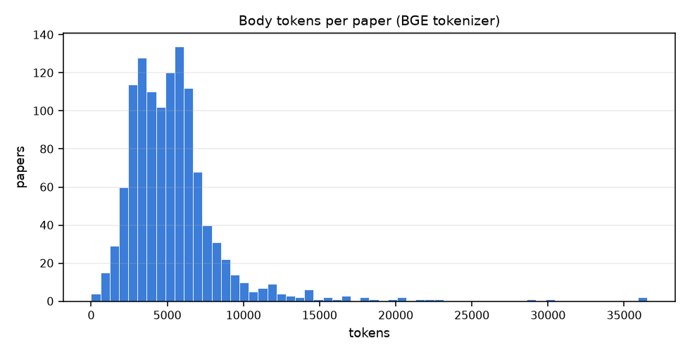
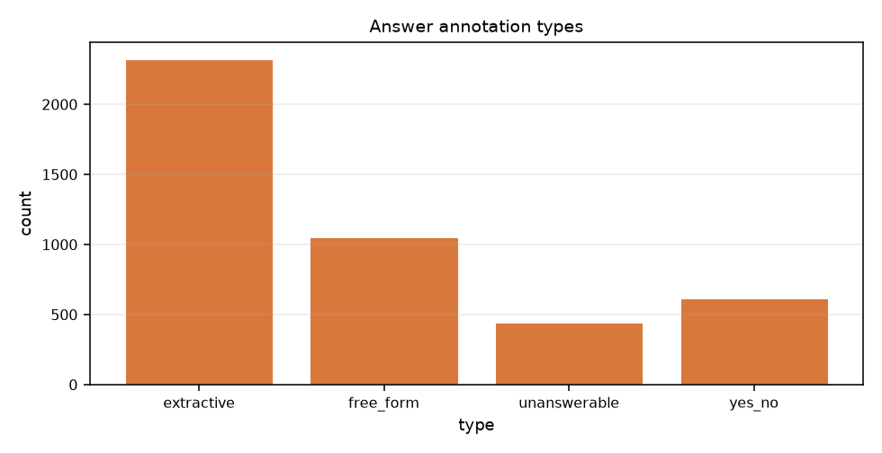
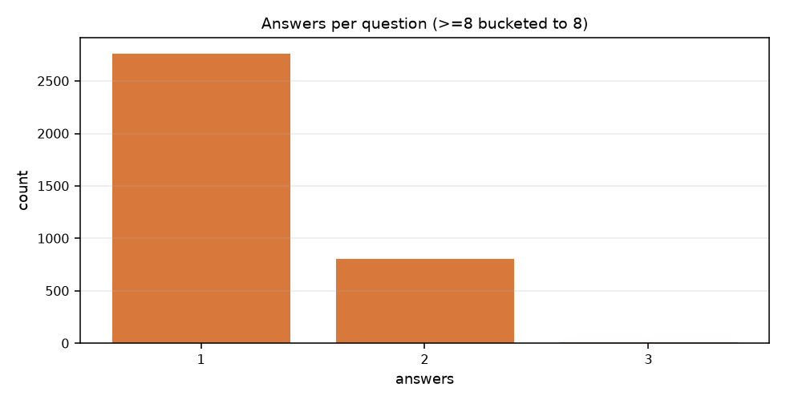
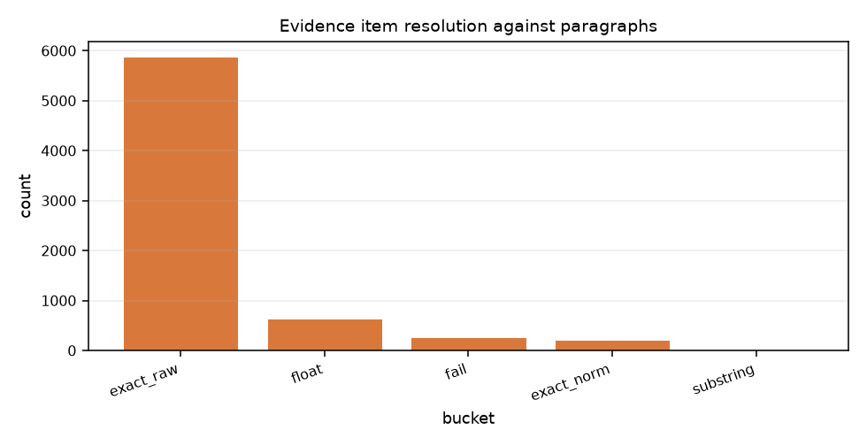

# QASPER 数据集摸底报告（P1）

> 生成时间：2026-10-31T17:35:22+00:00　|　tokenizer：`tokenizers-file:tokenizer.json`
> 本报告只做**测量**，不做任何清洗或改写；所有数字都可用 `python scripts/00_profile_dataset.py` 复现。

## 1. 规模总览

| split | papers | questions | answers | body_tokens | avg_body_tokens |
|---|---|---|---|---|---|
| dev | 281 | 1005 | 1764 | 1403395 | 4994.3 |
| train | 888 | 2593 | 2675 | 4867204 | 5481.1 |

- 全语料正文 **6,270,599** tokens（含摘要 222,942）
- 问题 **3,598** 条，答案标注 **4,439** 条

## 2. 顶层字段（真实 dump，不是文档抄的）

| keys | papers | pct |
|---|---|---|
| abstract \| figures_and_tables \| full_text \| qas \| title | 1169 | 100 |

## 3. 文本规模分布

| metric | n | mean | p50 | p90 | p99 | max |
|---|---|---|---|---|---|---|
| body_tokens | 1169 | 5364.07 | 5032 | 8271.8 | 17794.4 | 36529 |
| body_chars | 1169 | 23753.2 | 22814 | 34245.4 | 79173.2 | 168561 |
| abstract_tokens | 1169 | 190.71 | 184 | 268 | 361.64 | 419 |

## 4. 文档结构

| metric | mean | p50 | p90 | p99 | max |
|---|---|---|---|---|---|
| sections_per_paper | 13.9 | 13 | 21 | 36 | 49 |
| paras_per_section | 3.77 | 2 | 8 | 21 | 627 |
| paragraph_tokens | 102.33 | 86 | 205 | 372 | 3636 |

| check | value |
|---|---|
| 总段落数 | 61,281 |
| 空段落数（text.strip()==''） | 1133 (1.849%) |
| 无 section 的论文 | 1 |
| 无摘要的论文 | 0 |
| **存在 section_name 重名的论文** | 0 (0.0%) |
| 重复名称的额外出现次数 | 0 |

## 5. 问题与答案

| metric | mean | p50 | p90 | p99 | max |
|---|---|---|---|---|---|
| qas_per_paper | 3.08 | 3 | 5 | 8.32 | 12 |
| answers_per_question | 1.23 | 1 | 2 | 2 | 3 |
| evidence_per_question | 1.95 | 1 | 4 | 12 | 74 |
| highlight_per_question | 1.64 | 1 | 3 | 7 | 15 |

| check | value |
|---|---|
| 没有答案的问题数 | 0 |
| 违反『仅一个答案字段非空』的标注数 | 0 (0.0%) |

**单个标注的答案类型分布**

| answer_type | count | pct |
|---|---|---|
| extractive | 2325 | 52.38 |
| free_form | 1053 | 23.72 |
| unanswerable | 444 | 10 |
| yes_no | 617 | 13.9 |

**单个问题的答案类型组合**（多标注者可能给出不同类型）

| type_combo | count | pct |
|---|---|---|
| extractive | 1745 | 48.5 |
| extractive+free_form | 193 | 5.36 |
| extractive+unanswerable | 29 | 0.81 |
| extractive+yes_no | 1 | 0.03 |
| free_form | 748 | 20.79 |
| free_form+unanswerable | 25 | 0.69 |
| free_form+yes_no | 4 | 0.11 |
| unanswerable | 331 | 9.2 |
| unanswerable+yes_no | 28 | 0.78 |
| yes_no | 494 | 13.73 |

## 6. Evidence 形态与可对齐性 ★

这是 P6 能否顺利的唯一判据。

| bucket | count |
|---|---|
| 全部 evidence 条目 | 7017 |
| `FLOAT SELECTED`（图表证据） | 639 (9.11%) |
| 空字符串 | 0 |
| **文本证据（对齐全部分母）** | 6378 |
| └ 原文精确匹配 | 5883 |
| └ 归一化后精确匹配 | 219 |
| └ 仅子串（containment）匹配 | 11 |
| └ 命中摘要而非正文 | 0 |
| └ **完全失败** | 265 |
| **文本证据可对齐率** | **95.85%** |
| highlighted_evidence 落在某段落内 | 79.3% (5907 条) |

**对齐失败样例（供人工判读）**

- `1908.06606` … Experimental Studies ::: Comparison with State-of-the-art Methods
- `1912.13072` … Data and Models ::: Emotion
- `2002.06644` … Baselines and Approach
- `2002.06644` … Baselines and Approach ::: Baselines
- `2002.06644` … Experiments ::: Dataset and Experimental Settings
- `1707.00995` … Hard Stochastic attention
- `2003.08553` … System description ::: Architecture
- `1909.09491` … Evaluation ::: Plackett-Luce Model for SMT Reranking

## 7. S2ORC 占位符（BIBREF / TABREF / FIGREF）

| type | occurrences |
|---|---|
| BIBREF | 49568 |
| FIGREF | 3859 |
| TABREF | 4546 |

- 含占位符的段落：**22,570** （占全部段落 36.83%）
- 每篇论文占位符数：均值 49.59，p90 83.0，max 862.0

样例：

> BIBREF0 constructed a network of events using word embedding-derived similarities. Compared with this method, our discourse relation-based linking of events is much simpler and more intuitive.

## 8. 写作元数据（Eval 组可做分层分析）

**nlp_background**

| nlp_background | count | pct |
|---|---|---|
| (empty) | 760 | 21.12 |
| five | 1086 | 30.18 |
| infinity | 785 | 21.82 |
| two | 470 | 13.06 |
| zero | 497 | 13.81 |

**topic_background**

| topic_background | count | pct |
|---|---|---|
| (empty) | 889 | 24.71 |
| familiar | 1009 | 28.04 |
| research | 164 | 4.56 |
| unfamiliar | 1536 | 42.69 |

**paper_read**

| paper_read | count | pct |
|---|---|---|
| (empty) | 889 | 24.71 |
| no | 2543 | 70.68 |
| somewhat | 141 | 3.92 |
| yes | 25 | 0.69 |

- `search_query` 非空比例：**31.46%**
- 每篇论文图表数：均值 7.26，p90 12.0，max 78.0
