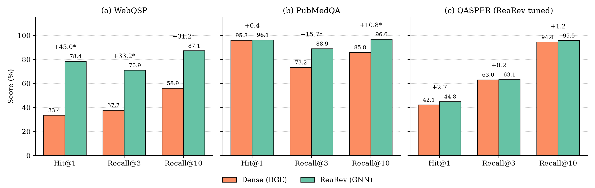
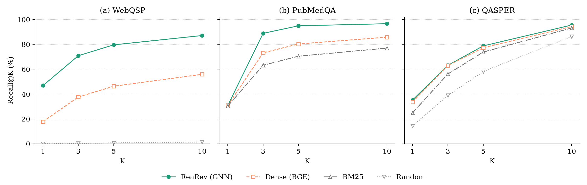

# GNN-RAG（ReaRev）与 Dense 检索：三数据集对比实验

**研究问题**：在检索证据这一步，加入图结构的 GNN 检索器（ReaRev）是否优于纯稠密检索（Dense）？在三个图结构差异很大的数据集上对比。

**结论**：图的作用取决于结构本身是否携带信息。

- **WebQSP**（原生知识图谱，需要多跳）：ReaRev 全面大幅领先。
- **PubMedQA**（引文和同篇相邻边）：找对论文的能力两者持平，但 ReaRev 能把同一篇论文的其他段落一起召回，Recall 显著提高 11–16 个百分点。
- **QASPER**（单篇论文内构造的图，只需 1 跳）：照搬 WebQSP 的超参数时 ReaRev 显著落后；按 QASPER 的图结构调参后与 Dense 持平，没有显著差异。

## 1. 方法

| 方法 | 说明 |
|---|---|
| **ReaRev**（GNN） | GNN-RAG 中的 GNN 检索器 [1, 2]，在每道题的子图上有监督训练，按节点概率排序。QASPER 和 PubMedQA 的节点特征为冻结的 BGE(q)⊙BGE(c)。 |
| **Dense**（基线） | BGE-small-en-v1.5 [3]，零样本余弦相似度排序。QASPER 和 WebQSP 使用组员（Member 2）的原实现；PubMedQA 使用同一模型和同一编码配置。 |
| BM25 / 随机 / 阅读顺序 | 不训练的下限基线。 |

只评测检索，不评测 LLM 生成的答案。所有方法在同一候选池、同一 gold、同一分母下，由同一个评分脚本打分。

## 2. 数据集

| 数据集 | 任务 | 候选池 | 图 | 训练 / 选模 / 测试 |
|---|---|---|---|---|
| WebQSP | 知识图谱问答：找答案实体 | 每题子图中的候选节点（约 1,100 个） | Freebase 原生关系，多跳 | 官方 train / dev / test；test 1,639 题，可评 1,551 题 |
| QASPER | 论文证据定位：找证据段落 | 本篇论文的全部 chunk（约 16 个） | 根→候选、阅读顺序、篇内相似边 | 原始 train（留出 15% 论文作 dev）/ 原始 dev 作 test：1,005 题，可评 890 题 |
| PubMedQA | 跨文档检索：找出处论文的全部 chunk | 全语料 3,707 个 chunk（1,395 篇论文） | 引用边、同篇相邻、相似边 | 按题划分 571 / 95 / 285（seed 20261109） |

PubMedQA 的引文语料来自组员的 `scripts/20_expand_pubmedqa_corpus.py` 和 `scripts/21_build_pubmedqa_graph.py`，参照 CG-RAG [4] 的构造方式。

## 3. 指标

Hit@K、Recall@K、MRR@K，K = 1 / 3 / 5 / 10。Hit 和 Recall 以百分比表示，MRR 在 0–1 之间。

- **Hit@K**：前 K 个结果中至少有一个 gold。
- **Recall@K**：gold 中被前 K 个结果覆盖的比例。
- **MRR@K**：第一个 gold 出现位置的倒数。

差异的显著性用逐题配对 bootstrap（10,000 次）的 95% 置信区间判断。

## 4. 主要结果

*图 1：橙色柱为 Dense，青绿色柱为 ReaRev；每组上方数字为 ReaRev − Dense（百分点），带 \* 表示配对 bootstrap 95% 置信区间不含 0。*

**ReaRev − Dense**（Hit/Recall 单位为百分点，MRR 为绝对差；方括号内为 95% CI；\* 表示 CI 不含 0）

| 数据集 | ΔHit@1 | ΔRecall@3 | ΔRecall@10 | ΔMRR@10 |
|---|---|---|---|---|
| WebQSP | **+45.0\*** [42.1, 47.8] | **+33.2\*** [30.7, 35.6] | **+31.2\*** [28.9, 33.5] | **+0.388\*** [0.364, 0.412] |
| PubMedQA | +0.4 [−2.1, 2.5] | **+15.7\*** [13.0, 18.2] | **+10.8\*** [8.3, 13.4] | −0.007 [−0.026, 0.010] |
| QASPER（调参后） | +2.7 [−1.1, 6.5] | +0.2 [−3.1, 3.4] | +1.2 [−0.2, 2.6] | +0.011 [−0.015, 0.037] |
| QASPER（WebQSP 参数） | −1.6 [−5.5, 2.5] | −5.3\* [−8.7, −1.9] | +0.2 [−1.3, 1.7] | −0.030\* [−0.058, −0.002] |

*图 2：各数据集的 Recall@K 曲线（K = 1, 3, 5, 10）。*

### 各数据集的完整结果

**WebQSP**（test，1,551 题）

| 方法 | Hit@1 | Hit@3 | Hit@10 | Recall@1 | Recall@3 | Recall@5 | Recall@10 | MRR@10 |
|---|---:|---:|---:|---:|---:|---:|---:|---:|
| ReaRev | **78.40** | **87.69** | **94.26** | **46.85** | **70.87** | **79.62** | **87.11** | **0.8377** |
| Dense | 33.40 | 52.61 | 69.50 | 17.81 | 37.66 | 46.32 | 55.90 | 0.4493 |
| 随机（20 次） | 0.58 | 1.57 | 5.04 | 0.13 | 0.40 | 0.71 | 1.46 | 0.0154 |

**QASPER**（原始 dev，890 题）

| 方法 | Hit@1 | Hit@3 | Hit@10 | Recall@1 | Recall@3 | Recall@5 | Recall@10 | MRR@10 |
|---|---:|---:|---:|---:|---:|---:|---:|---:|
| ReaRev（调参后） | **44.83** | 71.91 | **97.53** | **35.23** | **63.15** | **78.78** | **95.55** | **0.6118** |
| ReaRev（WebQSP 参数） | 40.56 | 66.29 | 96.63 | 30.28 | 57.72 | 73.83 | 94.57 | 0.5704 |
| Dense | 42.13 | **73.03** | 96.85 | 33.70 | 63.00 | 77.33 | 94.37 | 0.6006 |
| BM25 | 31.57 | 67.53 | 96.52 | 24.90 | 56.20 | 73.79 | 93.18 | 0.5233 |
| 随机（50 次） | 19.83 | 49.05 | 91.04 | 14.31 | 38.98 | 58.08 | 86.36 | 0.3970 |

**PubMedQA**（test，285 题）

| 方法 | Hit@1 | Hit@3 | Hit@10 | Recall@1 | Recall@3 | Recall@5 | Recall@10 | MRR@10 |
|---|---:|---:|---:|---:|---:|---:|---:|---:|
| ReaRev | **96.14** | 97.19 | 97.54 | **30.86** | **88.86** | **94.93** | **96.63** | 0.9675 |
| Dense | 95.79 | **99.30** | **99.65** | 30.85 | 73.20 | 80.31 | 85.79 | **0.9747** |
| BM25 | 94.39 | 97.89 | 98.60 | 30.34 | 63.19 | 70.47 | 76.99 | 0.9624 |

PubMedQA 中每篇出处论文平均有 3.4 个 chunk，所以 Recall@1 的上限约为 30%。

## 5. 超参数

| | WebQSP | QASPER | PubMedQA |
|---|---|---|---|
| num_gnn / num_iter / num_ins | 3 / 3 / 2 | 2 / 1 / 3 | 2 / 2 / 3 |
| entity_dim | 50 | 256 | 128 |
| 训练轮数（选中的轮次） | 200（第 60 轮） | 30（第 18 轮） | 100 |
| 选模指标（dev） | H1 | H1 | F1 |
| 共同设置 | lr 5e-4、batch 8、seed 19960626、问题编码器 MiniLM（冻结） | 同左，节点特征为冻结的 BGE(q)⊙BGE(c) | 同左 |

- **QASPER**：照搬 WebQSP 的参数（3 层 GNN、50 维）时，dev H1 在第 6 轮就停在 0.33–0.37 不再提高。QASPER 每题约 16 个节点，只需 1 跳；传播层数过多会把节点表示抹平，50 维也会压缩 384 维的 BGE 特征。因此在 {1, 2} 层 × {1, 2} 轮推理 × {128, 256} 维上做了网格搜索，加上原配置共 9 组，按留出 dev 选出 2 层、1 轮、256 维。
- **PubMedQA**：按 F1 选模，因为找对论文很容易（各方法 Hit@1 都在 94% 以上），而 F1 能反映是否把同篇论文的所有 chunk 都排到前面。

## 6. 讨论与局限

- **图有用的条件**：WebQSP 的答案只能沿关系多跳到达，Dense 只看文本相似度，差距最大。PubMedQA 的增益来自同篇相邻边，它把排在第一的 chunk 的相关性传给同篇论文的其他 chunk。QASPER 的问题与证据段落主要靠语义匹配，BGE 已经很强，图带来的新信息有限。
- **超参数不能直接迁移**：同一模型在 QASPER 上照搬 WebQSP 的参数，结果显著变差；按数据集的图结构调整后才追平 Dense。
- **PubMedQA 的 Hit@3 和 Hit@10 略低约 2 个百分点**：ReaRev 在约 7 道题上完全没有找到出处论文，而 Dense 找到了。可能的原因是 ReaRev 把整篇 gold 论文排得很低，或 gold 不在候选子图中，原因尚未逐题核实。
- **与 CG-RAG 的关系**：CG-RAG 报告在 PubMedQA 上加图后 Hit@1 从 0.913 提高到 0.961（+4.8 个百分点）[4]。我们的语料（1,395 篇对 7,849 篇）和图的构造都不同，绝对数值不可比，只比较方向：我们的 Hit@1 已接近上限，增益体现在 Recall 上。
- **其他限制**：每个配置只训练了一次（单个 seed），置信区间只反映题目抽样，不反映训练随机性。ReaRev 为有监督训练，Dense 为零样本，差异不能全部归因于图结构。

## 7. 复现

数据转换和评分代码在 [`data_process/`](../../../data_process/README.md)，运行步骤见 [`data_process/gnn_runs/README.md`](../../../data_process/gnn_runs/README.md)。数值汇总见同目录的 [`metrics.json`](metrics.json)。

## 参考文献

1. Mavromatis, C., & Karypis, G. (2022). ReaRev: Adaptive Reasoning for Question Answering over Knowledge Graphs. In *Findings of the Association for Computational Linguistics: EMNLP 2022*, pp. 2447–2458.
2. Mavromatis, C., & Karypis, G. (2025). GNN-RAG: Graph Neural Retrieval for Efficient Large Language Model Reasoning on Knowledge Graphs. In *Findings of the Association for Computational Linguistics: ACL 2025*.
3. Xiao, S., Liu, Z., Zhang, P., Muennighoff, N., Lian, D., & Nie, J.-Y. (2024). C-Pack: Packed Resources For General Chinese Embeddings. In *Proceedings of the 47th International ACM SIGIR Conference on Research and Development in Information Retrieval (SIGIR '24)*.
4. Hu, Y., Lei, Z., Dai, Z., Zhang, A., Angirekula, A., Zhang, Z., & Zhao, L. (2025). CG-RAG: Research Question Answering by Citation Graph Retrieval-Augmented LLMs. arXiv:2501.15067.
